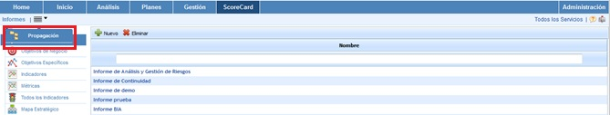
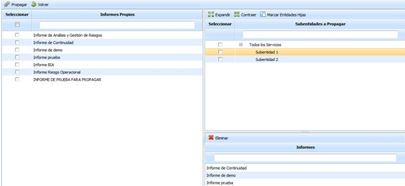

# Propagación Informes

La presente opción permite la propagar informes generados en la empresa matriz a las subentidades que dependen de esta.

Una vez se ha accedido a la opción, se muestran las siguientes tablas:

* **Tabla Informes Propios:** Muestra el listado de informes que se han definido en la empresa matriz. Las opciones que permite la tabla son:

  * **Propagar:** Una vez seleccionados los informes deseados permite propagar los mismos a las subentidades seleccionadas.
  * **Volver:** Ofrece la posibilidad de volver a la pantalla inicial de informes.
* **Tabla Subentidades:** Muestra el listado de subentidades a las que se pueden asociar los informes de la empresa matriz. Las opciones que permite la tabla son la de expandir o contraer el listado de subentidades, además de poder marcar todas las subentidades pulsando sobre el botón 'Marcar Entidades Hijas'.
* **Tabla Informes:** Una vez seleccionada la subentidad en la tabla superior, muestra el listado de informes que se han asociado a la misma. La herramienta ofrece la posibilidad de eliminar informes asociados, para ello se ha de seleccionar la fila deseada y pulsar sobre el botón 'Eliminar'.
