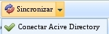
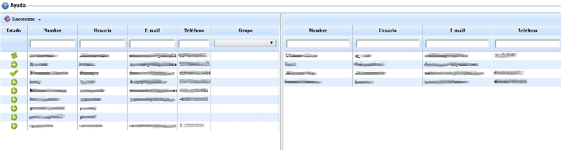
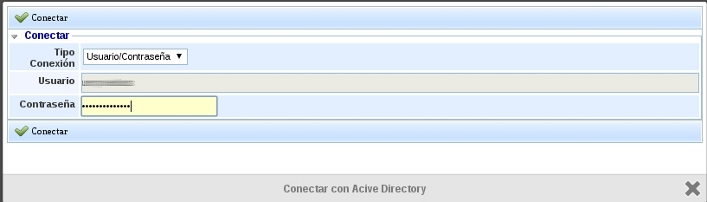
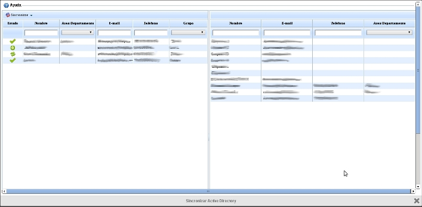
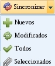

# Active Directory / LDAP

La sincronización de Active Directory o LDAP se puede realizar en dos lugares distintos de la herramienta.

1. En la sección Ajustes, opción [**Usuarios**](../ajustes/usuarios/README.md)

2. En la sección Gestión, opción [**Empleados**](../gestion/empleados.md)

## Usuarios

En la parte superior de la tabla de la opción Usuarios en el apartado de 'Ajustes' se puede ver el botón Sincronizar->Conectar Active Directory.

Una vez se pulse en el botón, aparecerá una ventana emergente para que se introduzca el usuario y contraseña para conectarse con el Active Directory.

Una vez autenticados ante el Active Directory aparecerán dos tablas, la de la izquierda nos mostrará a los usuarios del Active Directory definidos en la Configuración;y en la parte de la derecha los usuarios que tienen el Sistema de Gestión en GlobalSuite. Asimismo, hay una parte de Ayuda donde se explica el correcto funcionamiento de la sincronización. El estado del usuario del Active Directory respecto al sistema se divide en Nuevo, Modificado o Sincronizado; representados por un +, dos flechas formando un circulo y un tick respectivamente.

Si se pulsa sobre el botón de Sincronizar, se permite la opción de sincronizar los usuarios nuevos, los modificados, los seleccionados o todos. En el caso de que se produzca algún error al sincronizar debido a usuarios repetidos o que se haya superado el limite de los mismo, se nos alertara mediante una pantalla emergente. Una vez sincronizados, aparecerá de nuevo la pantalla de Usuarios, donde se podrá comprobar la correcta sincronización de los usuarios.

## Empleados

En la parte superior de la tabla de la opción Empleados en [Gestión](http://manual.globalsuite.es/index.php/Gesti%C3%B3n), se puede ver el botón Sincronizar->Conectar Active Directory.

Una vez que haya pulsado en el botón, aparecerá una ventana emergente para que introduzca el usuario y contraseña para conectarse con el Active Directory.

En el momento en el que se haya autenticado ante el Active Directory aparecerán dos tablas: la de la izquierda nos mostrará a los usuarios del Active Directory que han sido definidos en la Configuración; y en la parte de la derecha los empleados que tienen el Sistema de Gestión en GlobalSuite. Hay una parte de Ayuda donde se explica también el correcto funcionamiento de la sincronización. El estado del usuario del Active Directory respecto al sistema se divide en Nuevo, Modificado o Sincronizado; representados por un +, dos flechas formando un circulo y un tick respectivamente.

Si pulsa sobre el botón de Sincronizar, se permite la opción de sincronizar los empleados nuevos, los modificados, los seleccionados o todos.

