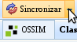
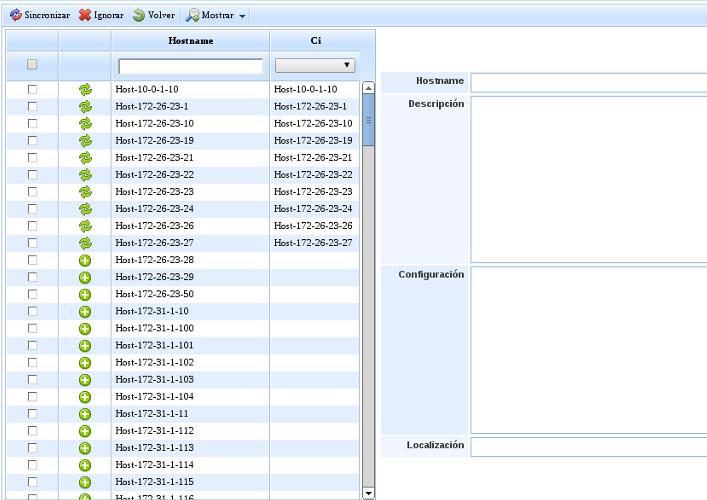

# OCS Inventory

En la barra superior se puede ver el botón Sincronizar->OCS Inventory.

Al pulsar el botón de 'Sincronizar' se solicitará que se introduzca la contraseña de acceso en la barra superior de la tabla, y aparecerá la pantalla pertinente para realizar la sincronización.

En la parte de la izquierda se muestran los elementos que existen en OCS Inventory. Si pulsa en un elemento, se mostrará la información Gde dicho elemento en la parte derecha de la pantalla.

Existe la posibilidad de sincronizar los elementos de OCS con CIs de la CMDB de GlobalSuite o ignorarlos.

Para sincronizar ambos elementos existen 2 posibilidades:

1.Seleccionando los elementos de OCS Inventory y pulsando el botón sincronizar,de esta manera se creará un nuevo CI por cada elemento sincronizado.

2.Relacionando los elementos de OCS Inventory con los CIs ya existentes, seleccionando el CI con el cual se quiere relacionar y que actualizará los datos del mismo si pulsamos sincronizar, en caso de no pulsarlo únicamente quedarán relacionados.
