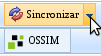
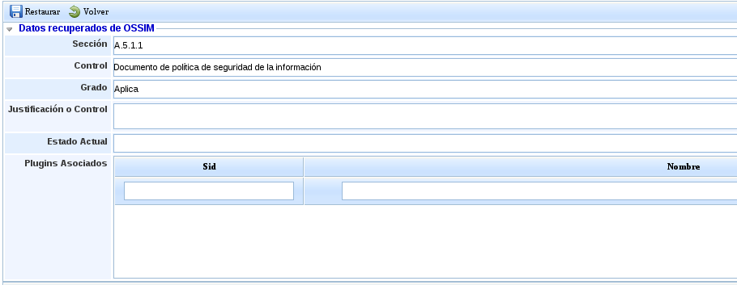
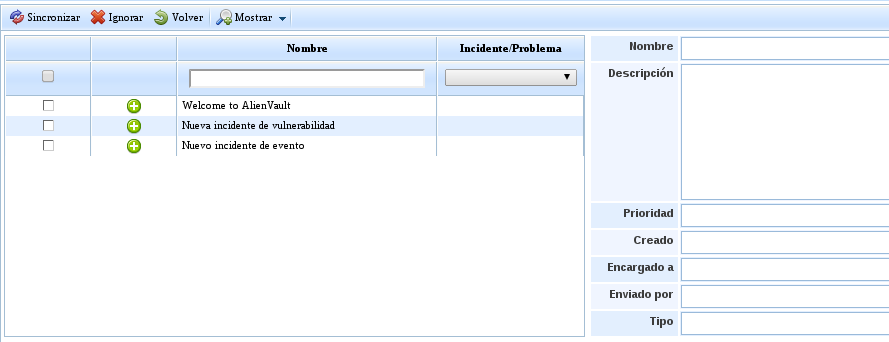

# OSSIM

La sincronización de OSSIM se puede realizar en tres partes distintas de la herramienta.

1. En la sección Análisis, opción [**CMDB**](../analisis/cmdb.md)

2. En la sección Análisis, opción [**Compliance**](../analisis/compliance/README.md)

3. En la sección Gestión, opción [**Incidencias y Problemas**](../gestion/incidencias-y-problemas/README.md)

## CMDB

En la barra superior se puede ver el botón Sincronizar→OSSIM.

Al pulsar el botón de Sincronizar se solicitará que se introduzca la contraseña de acceso en la barra superior de la tabla, y aparecerá la pantalla pertinente para realizar la sincronización.

En la parte de la izquierda se muestran los elementos que existen en OSSIM. Si pulsa en un elemento, se mostrará la información de dicho elemento en la parte derecha de la pantalla.

Existe la posibilidad de sincronizar los elementos de OSSIM con CIs de la CMDB de GlobalSuite o ignorarlos.

Para sincronizar ambos elementos existen 2 posibilidades:

1.Seleccionando los elementos de OSSIM y pulsando el botón sincronizar,de esta manera se creará un nuevo CI por cada elemento sincronizado.

2.Relacionando los elementos de OSSIM con los CIs ya existentes, seleccionando el CI con el cual se quiere relacionar y que actualizará los datos del mismo si pulsamos sincronizar, en caso de no pulsarlo únicamente quedarán relacionados.

## Compliance

La sincronización se puede realizar a través del listado de SOAs, sincronizando todos los controles, o uno por uno desde la SOA. Asimismo, GlobalSuite solamente permite la sincronización de la SOA activa.

En la barra superior del listado se puede ver el botón Sincronizar->OSSIM, que estará disponible siempre y cuando se tenga seleccionada la SOA activa.

Si pulsa el botón 'Sincronizar' se solicitará que se introduzca la contraseña de acceso en la barra superior de la tabla, y se actualizarán todos los controles de la SOA de GlobalSuite con los valores que tiene la SOA en OSSIM.

En la barra superior de la SOA activa se puede ver el botón Sincronizar->OSSIM, que estará disponible siempre y cuando se tenga seleccionado un control.

Si pulsa el botón 'Sincronizar' se solicitará que se introduzca la contraseña de acceso en la barra superior de la tabla, y aparecerá una pantalla emergente que permite realizar la sincronización.

En esta pantalla emergente se muestran los datos del control que se tienen en OSSIM, y al pulsar el botón Restaurar, se actualizarán dichos datos en el control de la SOA de GlobalSuite.

## Incidencias y Problemas

En la barra superior se puede ver el botón Sincronizar→OSSIM.

Si pulsa el botón 'Sincronizar' se solicitará que se introduzca la contraseña de acceso en la barra superior de la tabla, y aparecerá la pantalla para realizar la sincronización.

En la parte de la izquierda se muestran las incidencias que se han generado en OSSIM. Si selecciona en una incidencia, se mostrará la información en la parte de la derecha.

Existe la posibilidad de sincronizar las incidencias de OSSIM con las Incidencias de GlobalSuite o ignorarlas.

Para sincronizar ambas incidencias existen 2 posibilidades:

1.Seleccionando las incidencias de OSSIM y pulsando el botón sincronizar,de esta manera se creará una nueva incidencia por cada incidencia que haya sido sincronizada desde OSSIM.

2.Relacionando las incidencias de OSSIM con las incidencias ya existentes en GlobalSuite, seleccionamos la incidencia con la cual se quiere relacionar,y actualizará los datos de la misma si pulsamos el botón 'Sincronizar'.
