# SAML

## Conexión con SAML 2.0

Para llegar a la pantalla de conexión a SAML, es necesario situarse en la sección de Ajustes de GlobalSuite®, concretamente en la opción “Conexiones” (como se muestra en la imagen). A esta opción tienen acceso los usuarios de tipo Platinum, Gold, Consulting, Administrador Consulting, Administrador Plataforma, Administrador Enterprise y Administrador Configuración.

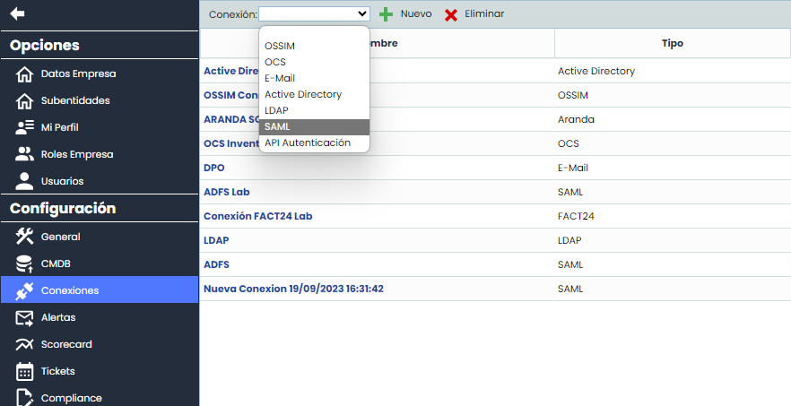

Esta pantalla tiene varias columnas que se describen a continuación:

* **Nombre**: Contiene el nombre de la conexión, que sirve para identificarla.
* **Tipo**: Contiene el tipo de conexión, en este caso será SAML.
* **Host**: En este caso estará vacío.
* **Usuario**: No es necesario por lo tanto aparece vacío.
* **Habilitado**: Indica si una conexión está habilitada o no.

El formulario de conexión a SAML consta de diferentes campos, los cuales se describen a continuación.

En primer lugar, se encuentra la sección de “Datos Generales”:

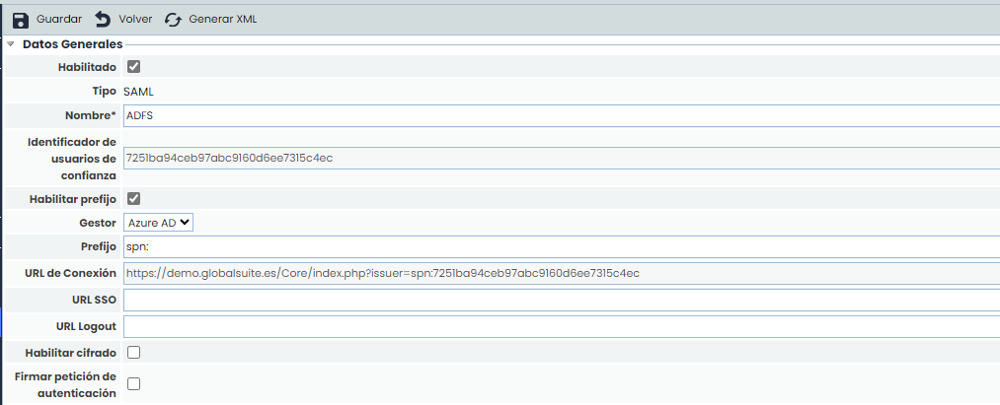

* **Habilitado:** Indica que esa conexión de SAML está habilitada. No se pueden tener dos conexiones de SAML activadas a la vez.
* **Tipo:** Indica el tipo de la conexión (en este caso, SAML).
* **Nombre\*:** Es un campo obligatorio, e indica el nombre de esa conexión para ser utilizada en otras opciones de la herramienta.
* **Identificador de confianza:** Se genera de forma automática. Indica la cadena de confianza que se establece entre el servidor de SAML y GlobalSuite®, esta debe ser única.
* **Habilitar prefijo:** Permite activar en caso de que se quiera personalizar y añadir un prefijo a la conexión, ya que algunos servicios requieren una estructura concreta.

  * **Gestor:** Permite elegir qué servidor IdP se va a configurar, permitiendo elegir entre ADFS, Azure AD, Google, Otro
  * **Prefijo:** Se propone un prefijo por defecto que irá en la URL de conexión en función del gestor: ADFS (Vacío), Azure AD (spn:), Google (https://), Otro (vacío). Este prefijo es editable.
* **URL de Conexión:**URL automática a la cual se tendrá que acceder para loguearse en GlobalSuite® mediante SSO a través del método SP Initiated.
* **URL SSO:** Cuando se desea configurar una conexión usando el método SP initiated SSO, se debe introducir la url del servicio del IdP donde se realiza la autenticación vía SAML2.
* **URL Logout:** Dirección a la que se redirige cuando un usuario con autenticación ADFS cierra la su sesión. Si se deja vacío, redirigirá a la vista de login de GlobalSuite®.
* **Habilitar cifrado:** Configuración de la conexión SAML que permite que los parámetros que se reciben desde el IdP vayan cifrados.
* **Firmar petición de autenticación:** Indica que, usando la configuración SP initiated SSO, la petición de autenticación que se realiza al IdP será firmada.

En segundo lugar, se encuentra la sección "Roles":

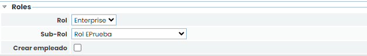

* **Rol**: Permite seleccionar qué tipo de rol por defecto tendrán los usuarios que se creen con el primer acceso.
* **Sub-Rol**: Además del rol general, se puede especificar un [Rol de Empresa](../ajustes/roles-de-empresa.md) específico, dentro de los que se encuentran configurados.
* **Crear empleado**: Si se marca este campo, cuando se cree un usuario con el primer acceso, también se creará el empleado asociado, con los mismos datos.

En principio los roles pueden ser obtenidos directamente del servidor IdP, en caso de no recibir datos sobre el rol o que los datos que se reciban sean erróneos se utilizarán los roles configurados en esta sección.

En tercer lugar, se encuentra la sección “Certificado IDP”. En esta sección se debe subir un archivo, con extensión **crt**, que contiene el certificado. Este certificado deber ser el mismo que se utiliza para firmar las llamadas desde el servidor SAML para la relación de confianza configurada.

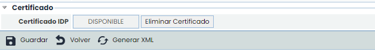

## Configuración Servidor ADFS con SAML 2.0

La url de servicio de conexión SAML 2.0 que se debe introducir en la configuración del servidor es:

https://Nombre\_Dominio/Core/Adfs/trust.php

Donde *Nombre\_Dominio* es la url de acceso a GlobalSuite®.

En la configuración del servidor ADFS se debe indicar que los datos a pasar en la petición son como mínimo:

* Id. Nombre (*nameidentifier*)
* Dirección de correo electrónico (*emailaddress*)

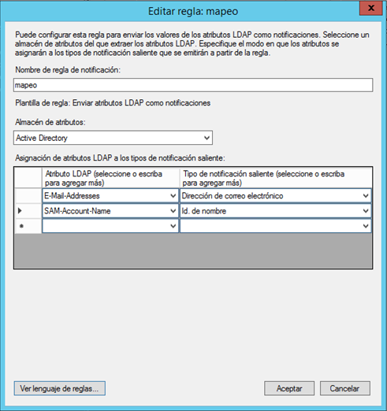

Si se desea enviar la configuración del rol para crear los nuevos usuarios de ADFS deberá utilizarse el claim llamado *role*:

<http://schemas.microsoft.com/ws/2008/06/identity/claims/role>

IMPORTANTE: El nombre del rol que se envía desde el servidor de ADFS debe coincidir con alguno de los roles configurados en GlobalSuite®.

Para obtener más información sobre la configuración del servidor ADFS puede acceder a:

<https://docs.microsoft.com/es-es/windows-server/identity/ad-fs/operations/create-a-relying-party-trust>

## Autenticación ADFS con SAML 2.0

Existen dos tipos de autenticación con ADFS:

* **IDP initiated SSO**, el proceso de autenticación es iniciado por el idp, el usuario dispone de una lista de “aplicaciones corporativas”, selecciona la que corresponde de GlobalSuite® e inicia la autenticación. A continuación, se muestra una imagen tipo de este formulario de aplicaciones.

* **SP initiated SSO**, el proceso de autenticación es iniciado por GlobalSuite®, para usar este método se debe acceder con una url específica. Esta url se forma concatenando la url de GlobalSuite® con el texto: ?issuer=identificador de confianza, donde el identificador de confianza es el código generado en la conexión y que puede encontrase en el campo con el mismo nombre, ver apartado 1 de este documento.  
  Un ejemplo de url es:  
  <https://sg.globalsuite.es/Core/index.php?issuer=a443c212c23af8ea8a107af75345>

La autenticación con ADFS tiene las siguientes particularidades:

* Si el usuario está accediendo por primera vez a la herramienta, a través de ADFS, se creará un usuario automáticamente con el nombre de usuario que se provee en la petición SAML, y el resto de atributos mapeados.
* Si el nombre de usuario ya existe en GlobalSuite® y no es el mismo que se ha creado en la primera conexión se lanzaría un mensaje de error.

## Configuración Azure AD con SAML 2.0

Para configurar GlobalSuite® como aplicación autorizada en Azure es necesario ingresar a “Aplicaciones empresariales” y dar clic en *Nueva aplicación*.

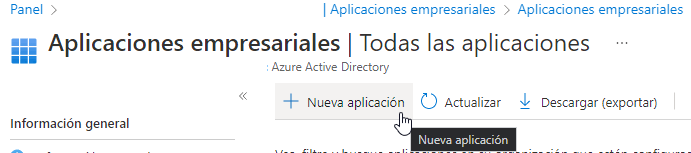

A continuación, es necesario pulsar en *Cree su propia aplicación*.

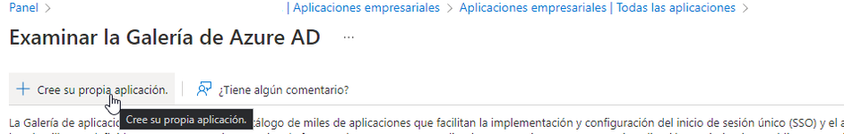

Indicar un nombre para la aplicación y pulsar “Crear”.

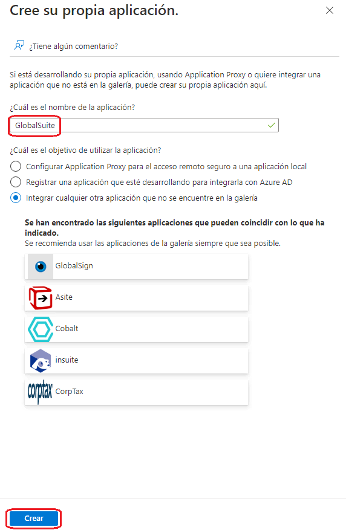

Acceder a la opción de “Inicio de sesión único” para configurar la conexión, seleccionando SAML:

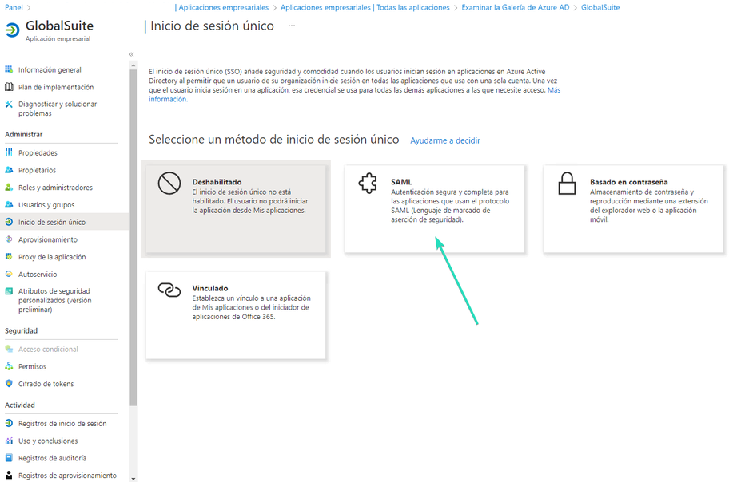

En la opción de “Inicio de sesión único” nos permite cargar el metadata obtenido de GlobalSuite® (que se obtiene con el botón Generar XML). Tras cargarlo, si este es correcto, se completarán los campos obligatorios de la configuración.

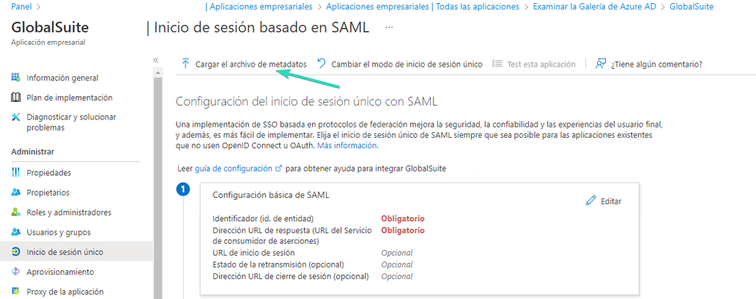

Al pulsar Editar se podrá incluir el Identificador único de confianza y la URL de GlobalSuite®:

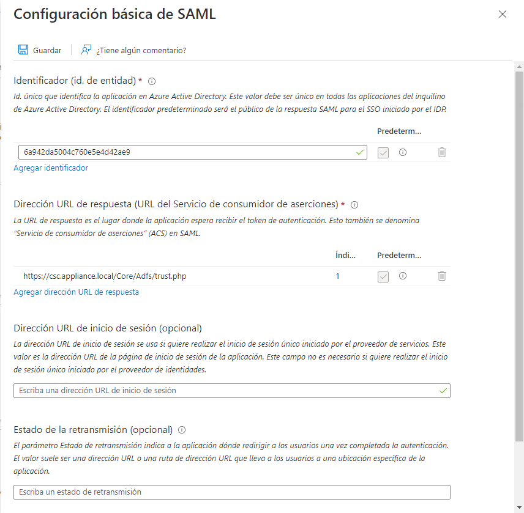

Se descargará el certificado, codificado en base64 para poder cargarlo en la conexión de GlobalSuite®

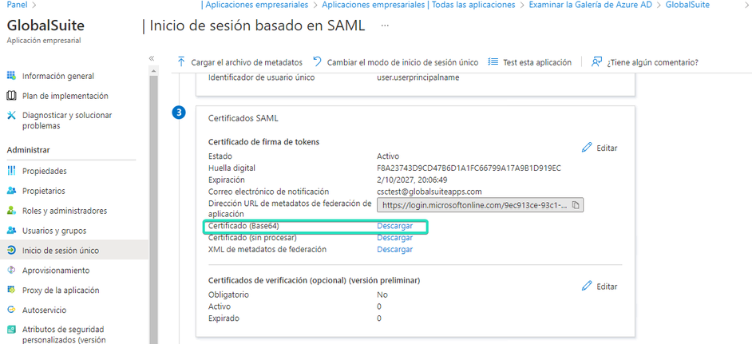

La url de SSO que habrá que solicitar para cargar en GlobalSuite® es la siguiente:

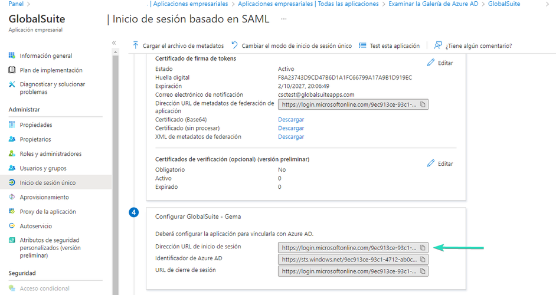

A continuación hay que autorizar los usuarios que tendrán acceso a la aplicación, desde la opción “Usuarios y grupos”, y el botón "Agregar usuario o grupo"

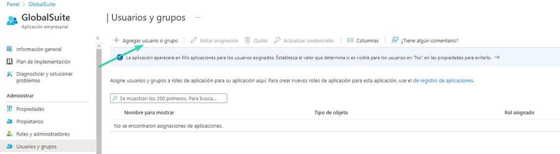

Una vez configurado los usuarios y/o grupos autorizados, se puede probar el acceso a la aplicación, lo cual se puede acceder directamente con la url del mecanismo **SP initiated**.

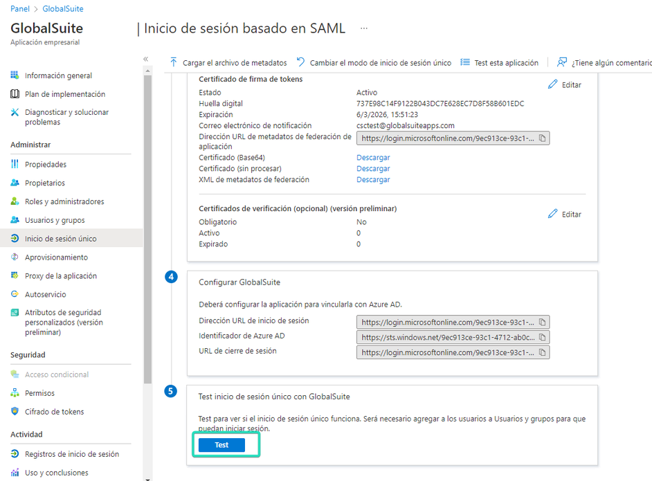

Esto nos llevará al portal y se nos presentará la aceptación de condiciones del servicio para el usuario (obligatorio en el primer acceso). Una vez aceptadas, tendrá acceso a la herramienta según el rol configurado por defecto.

Si el cliente usa el mecanismo IdP initiated, se puede configurar en esta opción la url de inicio de sesión proporcionada:

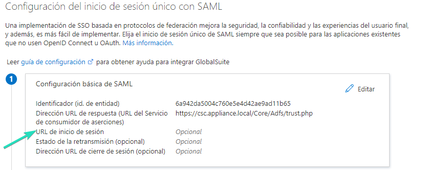

Si se quiere personalizar alguno de los parámetros por defecto que mapea Azure AD y envía a la aplicación (GlobalSuite) para crear y dar acceso al usuario se puede realizar desde ese apartado:

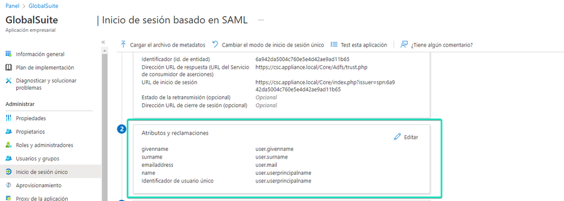
