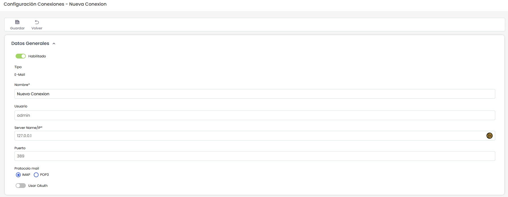
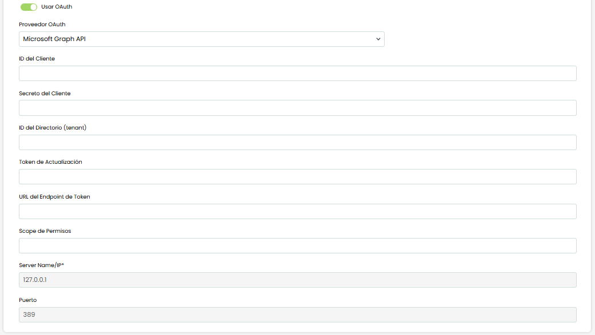
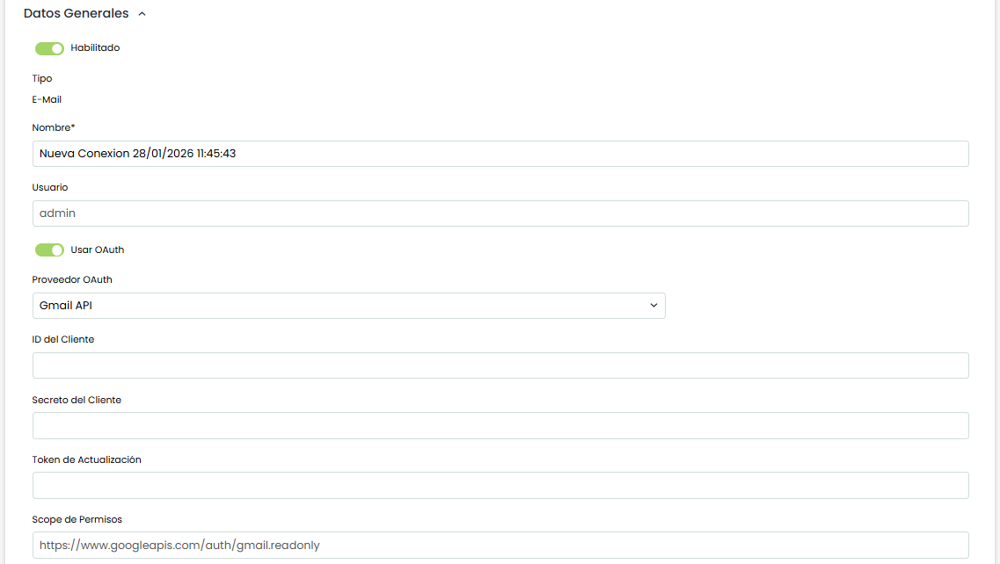
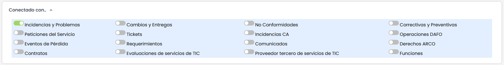

# Sincronización E-Mail

En este apartado se explica cómo poder configurar una conexión a un servicio / buzón de correo electrónico para poder utilizarlo para sincronizar los correos recibidos como [Tickets](../gestion/tickets.md) en el módulo de GlobalSuite®.

## Datos Generales

Los apartados para configurar (que para poder editarlos es necesario habilitar la conexión) son los siguientes:

* **Nombre:** Nombre o identificador del conector
* **Usuario:** User o cuenta de correo utilizada para la sincronización
* **Server Name / IP:** Dirección, dominio o ruta del servidor de correo al que conectar
* **Puerto:** Puerto de conexión para el servidor de correo
* **Protocolo mail:** Protocolo utilizado para obtener los correos electrónicos (POP3 / IMAP)


\*\*NOTA:\*\* La contraseña del usuario deberá introducirse en el momento de realizar la sincronización, no se almacena ese dato en GlobalSuite®


## OAuth

En caso de realizar la autenticación mediante protocolo OAuth, existen dos posibles proveedores a utilizar, que son:

### Microsoft Graph API

Los campos a completar son los siguientes:

* **ID del Cliente:** identificador público de la aplicación registrada en el proveedor OAuth, usado para solicitar tokens en su nombre.
* **Secreto del Cliente:** clave confidencial de la aplicación (tipo “contraseña” de la app) que se usa junto al ID del Cliente para autenticarse al pedir un token.
* **ID del Directorio (tenant):** identificador del tenant/directorio (p. ej., Azure AD) donde está registrada la aplicación y contra el que se emiten los tokens.
* **Token de Actualización:** token de larga duración que permite obtener nuevos *access tokens* sin repetir el consentimiento/login del usuario (típico en Gmail).
* **URL del Endpoint de Token:** URL del servicio OAuth donde se intercambian credenciales (y/o refresh token) para obtener el *access token*.
* **Scope de Permisos:** lista de permisos solicitados que define qué puede hacer el token (p. ej., leer correos, modificarlos/marcarlos como leídos, etc.).

### Gmail API

Los campos a completar para conectar con una cuenta de correo de Gmail (o GSuite) son los siguientes:

* **ID del Cliente:** identificador público de la aplicación registrada en el proveedor OAuth, usado para solicitar tokens en su nombre.
* **Secreto del Cliente:** clave confidencial de la aplicación (tipo “contraseña” de la app) que se usa junto al ID del Cliente para autenticarse al pedir un token.
* **Token de Actualización:** token de larga duración que permite obtener nuevos *access tokens* sin repetir el consentimiento/login del usuario (típico en Gmail).
* **Scope de Permisos:** lista de permisos solicitados que define qué puede hacer el token (p. ej., leer correos, modificarlos/marcarlos como leídos, etc.).

## Conectado con

Permite marcar en qué opciones de Ticketing (para qué tipos de ticket) estará disponible la sincronización de esta conexión. El mapeo de qué campos del correo electrónico, como remitente, asunto y cuerpo del correo, se cargan en qué campos del ticket creado se configurarán en Ajustes > Configuración > [Tickets: Email](../ajustes/configuracion-tickets/tickets-email.md)

