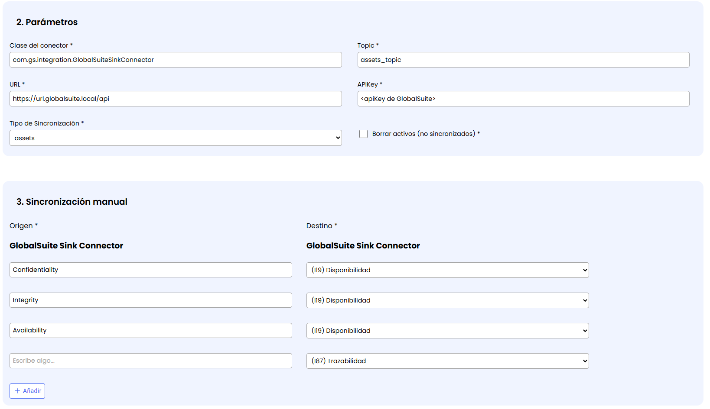
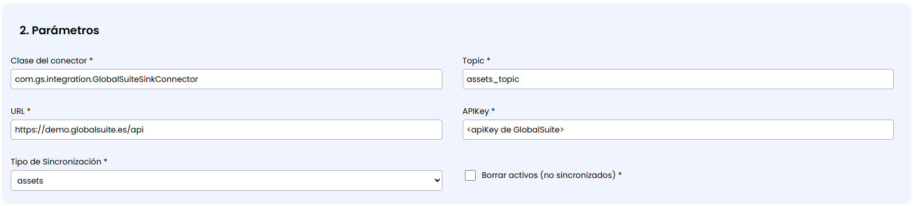
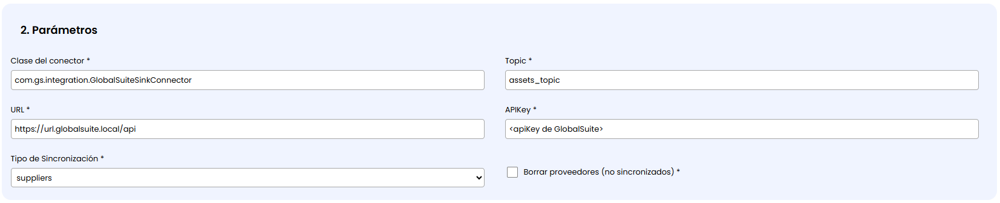
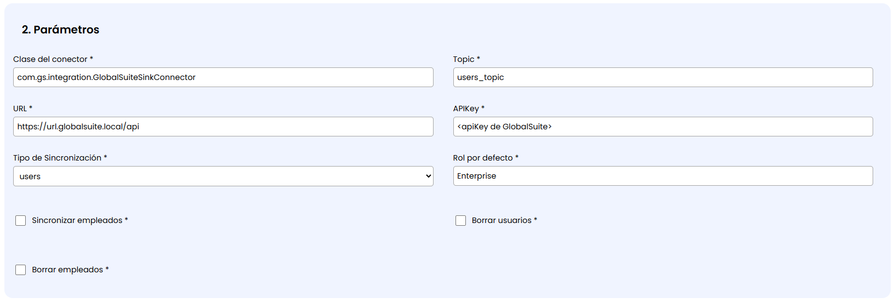
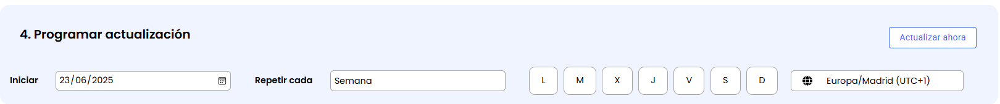

# GlobalSuite Sink Connector

|  |  |
| --- | --- |
|  | **Conector para enviar desde GlobalSuite usuarios, grupos, roles y atributos de identidad hacia GlobalSuite o hacia el sistema destino definido.**  **Etiquetas:** Usuarios | Proveedores | Elementos | Empleados | Seguridad |

|  |  |
| --- | --- |
| Herramienta o sistema | GlobalSuite |
| Fabricante de la herramienta | GlobalSuite Solutions |
| Proveedor del conector | GlobalSuite Solutions |
| Nombre del conector | GlobalSuite Sink Connector |
| Tipo de conector | Sink |
| Etiquetas | Usuarios | Proveedores | Elementos | Empleados | Seguridad |
| Información que maneja | usuarios, grupos, roles y atributos de identidad |

## Descripción

Este conector permite realizar la carga y actualización en distintos apartados de GlobalSuite GRC de la información proveniente de otros conectores de lectura (Source).

En concreto, existen modelados 3 casos de uso modelados para cargar la información en GlobalSuite:

* **Usuarios, empleados y roles**: Permite cargar información de personas y grupos como [usuarios](https://globalsuitesolutions.atlassian.net/wiki/spaces/GlobalSUITEes/pages/266863797/Usuarios) que acceden a GlobalSuite, [empleados](https://globalsuitesolutions.atlassian.net/wiki/spaces/GlobalSUITEes/pages/266863204/Empleados) del sistema de gestión, y [roles](https://globalsuitesolutions.atlassian.net/wiki/spaces/GlobalSUITEes/pages/266863574/Gesti+n+de+Roles) asociados.
* **Activos**: Sirve para cargar información de activos corporativos en el apartado de [Inventario](https://globalsuitesolutions.atlassian.net/wiki/spaces/GlobalSUITEes/pages/266864248/Inventario) y cargar sus valoraciones como dimensiones de la [Metodología de Elementos](https://globalsuitesolutions.atlassian.net/wiki/spaces/GlobalSUITEes/pages/266864054/Metodolog+a+Elementos)
* **Proveedores**: Permite cargar los proveedores y terceras / cuartas partes de sistemas externos y cargarlos como [Proveedores](https://globalsuitesolutions.atlassian.net/wiki/spaces/GlobalSUITEes/pages/266863610/Proveedores), incluyendo la valoración o el scoring de los mismos.

## Características

* **Integración directa**: desde sistemas externos hacia GlobalSuite GRC.
* **Mapeo dinámico de campos**: conecta los campos de distintas fuentes con campos configurados en distintos apartados de la solución.
* **Autenticación segura**: Información segura con claves API y conexiones seguras TLS.
* **Validación previa de datos** para mantener integridad del sistema y evitar errores.
* **Trazabilidad y logs** de cada sincronización.

### Beneficios clave

* ✅**Centraliza la información** clave de otras plataformas en una única solución GRC.
* ✅**Ahorra tiempo** reduciendo tareas manuales de carga de datos.
* ✅**Mejora la precisión** al evitar tener información obsoleta o duplicada.
* ✅**Acelera el análisis y la toma de decisiones**, al tener toda la información disponible.
* ✅**Aumenta la trazabilidad y transparencia** en auditorías o revisiones.
* ✅**Impulsa la automatización** en flujos de cumplimiento, riesgos, seguridad y continuidad.

## Instalación

1. **Accede al Marketplace** de GlobalSuite® e instala el conector "GlobalSuite Sink".

2. Ve a **Configuración** y completa la información necesaria, incluyendo:

* **Topic**: Identificador de la fuente de la cual tiene que obtener los datos para sincronizar en GlobalSuite.  
  NOTA: Este topic tiene que coincidir con el de uno de los conectores Source que leen información de herramientas externos
* **URL**: La URL del entorno de GlobalSuite en la que escribirá
* **APIKey**: Clave de uso del API definida en GlobalSuite, en el apartado Ajustes > Usuarios > API-Key
* **Tipo de Sincronización**: Indica qué información va a escribir. Actualmente se cuenta con la posibilidad de cargar Activos, Usuarios ó Proveedores.

* **Mapeo de campos**: Es posible elegir qué campo del origen (indicado en el Topic) corresponde con qué campo del apartado GlobalSuite donde se cargará la información.

Esta configuración particular y parámetros específicos dependen del Tipo de Sincronización seleccionado:

**Activos**

En caso de que se seleccione este tipo de sincronización, aparece la opción de “**Borrar activos (no sincronizados)**“. En caso de marcarse, los elementos del Inventario de GlobalSuite que no se sincronicen desde el origen, se borrarán de forma automática.

Es importante marcar este campo únicamente si se quieren gestionar en GlobalSuite los activos que vengan sincronizados del conector, ya que en caso contrario se podrá perder información en el sistema de gestión.

Si no se marca el check, los elementos que no existan en la sincronización se mantendrán en GlobalSuite pero se indicarán con un prefijo “*(Baja)*“ en el nombre.

Cuando se configura este conector para este tipo, el mapeo de campos permite elegir en qué dimensión de la [Metodología de Elementos](https://globalsuitesolutions.atlassian.net/wiki/spaces/GlobalSUITEes/pages/266864054/Metodolog+a+Elementos) del Inventario se guardará cada campo de la fuente.

**Proveedores**

Al igual que con los activos, en caso de que se seleccione este tipo de sincronización, aparece la opción de “**Borrar proveedores (no sincronizados)**“. En caso de marcarse, los elementos del Inventario de GlobalSuite que no se sincronicen desde el origen, se borrarán de forma automática.

Es importante marcar este campo únicamente si se quieren gestionar en GlobalSuite los proveedores o terceros que vengan sincronizados del conector, ya que en caso contrario se podrá perder información en el sistema de gestión.

Si no se marca el check, los proveedores que no existan en la sincronización se mantendrán en GlobalSuite pero se indicarán con un prefijo “*(Baja)*“ en el nombre.

Cuando se configura este conector para este tipo, el mapeo de campos permite elegir en qué dimensión de la [Metodología de Elementos](https://globalsuitesolutions.atlassian.net/wiki/spaces/GlobalSUITEes/pages/266864054/Metodolog+a+Elementos) del Inventario se guardará cada campo de la fuente. También en qué campos de la [Configuración de Proveedores](https://globalsuitesolutions.atlassian.net/wiki/spaces/GlobalSUITEes/pages/615972868/Configuraci+n+de+Proveedores) se puede guardar parámetros que vengan de la sincronización.

**Usuarios**

Cuando se marca este Tipo de Sincronización, se pueden elegir los siguientes parámetros:

* Rol por defecto: qué rol de usuario tomarán por defecto las personas que se sincronicen en GlobalSuite
* Sincronizar empleados: Si se marca, además del usuario se creará un empleado asociado con los mismos datos personales
* Borrar usuarios (no sincronizados): Al marcarlo, los usuarios que ya no vengan en la sincronización se eliminarán de GlobalSuite
* Borrar empleados (no sincronizados): De igual manera, los empleados que no vengan en la sincronización se eliminarán completamente, y si no se marca, pasarán a estar definidos como “*Baja*”.

3. Define la **frecuencia de sincronización** (diaria, semanal, mensual).

Se puede indicar un día de Inicio de la sincronización, y una frecuencia de repetición:

Diaria: La sincronización de lanzará ininterrumpidamente todos los días, pudiendo elegir cada cuántas horas se lanza

Semana: Se podrán marcar qué días de la semana se lanza la sincronización del conector

Mensual: Se lanzará cada mes el mismo día de meses sucesivos a partir de la fecha de Iniciar la sincronización.

4. **Guarda** y **activa** la sincronización.

NOTA: Al activar la integración se lanzará de manera inmediata para continuar con la frecuencia indicada en la configuración.


Existe la posibilidad de probar la sincronización con un entorno de pruebas antes de pasar a producción. Pregúntale a la persona de contacto en GSS para más información.

