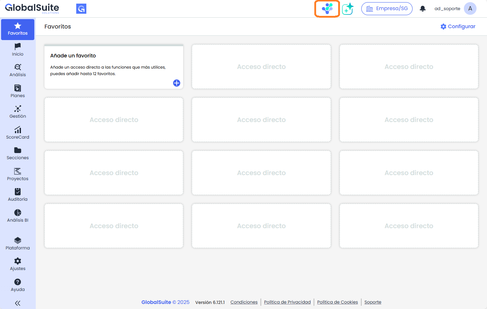
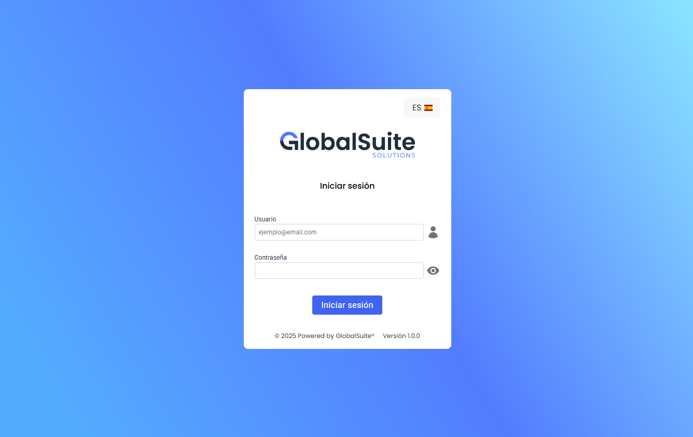
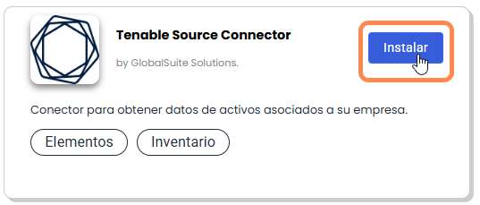
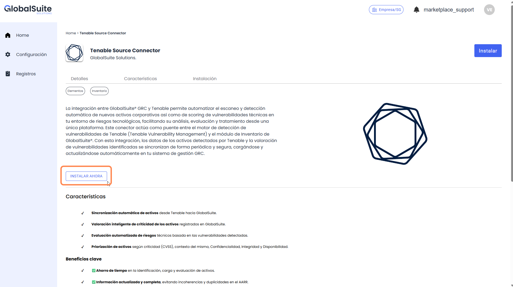
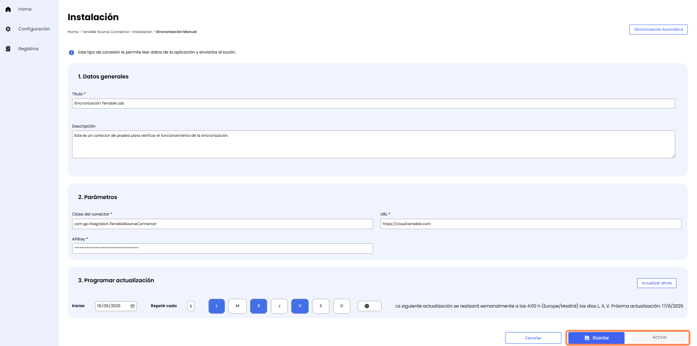
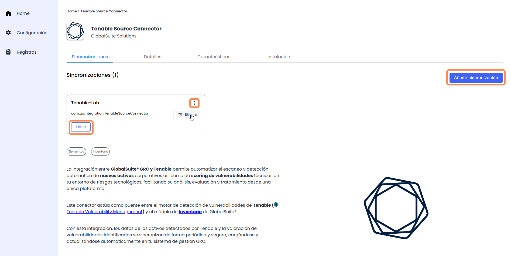

# Primeros Pasos - Marketplace

El Marketplace de Integraciones de GlobalSuite es una solución que permite realizar conexiones con herramientas comerciales de terceros o aplicaciones corporativas de desarrollo propio, incluso si no disponen de mecanismos estándar para la intercomunicación, como son APIs, webservices o webhooks, ya que disponen de conexión directa con Bases de Datos.

## Acceso al Marketplace

Para acceder al Marketplace de Integraciones, es necesario que tu instancia de GlobalSuite tenga activada la licencia para ello.


Disponible en la versión Enterprise o versiones superiores.


Una vez activada, se podrá acceder directamente pulsando en el icono que aparece en la parte superior de GlobalSuite.

También es posible entrar directamente desde la pantalla de login del propio marketplace (<https://marketplace.apps.globalsuitesolutions.com/>) con los mismos credenciales que el usuario de GlobalSuite GRC.

En caso de que tu usuario no esté habilitado para acceder al Marketplace (ver apartado [Usuarios](configuracion/usuarios.md)) se te mostrará un mensaje de error.

## Cómo configurar y activar un Conector

Dentro de la pantalla de Home, existe un catálogo de conectores disponibles. Para configurar un nuevo conector, hay que seguir los siguientes pasos:

1. Elegir el conector y pulsar en **Instalar** para entrar en el detalle del mismo

2. Dentro del detalle de un conector, donde podemos ver las características y modo de instalación, debemos pulsar en el botón **Instalar ahora**

*NOTA: En caso de tener ya alguna sincronización creada para este conector, nos aparecerá en este apartado para poder modificarla / eliminarla.*

3. En este paso hay que elegir qué tipo de configuración utilizar:

* [Sincronización automática](home/sincronizacion-automatica.md): Sirve para cargar directamente una configuración ya definida en formato JSON
* [Sincronización manual](home/sincronizacion-manual.md): Permite configurar mediante un formulario guiado, los campos necesarios para la sincronización, incluyendo mecanismos de autenticación, mapeos, frecuencia de actualización, etc.

4. Una vez completados los campos de la sincronización (URL de la aplicación, API-Key, Frecuencia de sincronización, etc.) se deberán guardar los cambios para permitir Activar la sincronización.

5. Una vez Activado, aparecerá la sincronización creada en el detalle del Conector

Pudiendo utilizar el botón **Editar** para acceder a la sincronización creada y modificar algún parámetro, borrar directamente la sincronización pulsando en el botón **Eliminar** del menú contextual, o añadiendo otra sincronización del mismo tipo mediante el botón **Añadir Sincronización** (ya que pueden convivir de manera activa varias sincronizaciones del mismo tipo de conector)

## Conectores disponibles

|  |  |  |
| --- | --- | --- |
| image-20250617-102917.png **Tenable**  [Más Información](https://globalsuitesolutions.atlassian.net/wiki/spaces/MIG/pages/1187545130/Tenable) |  | **Security Scorecard**  [Más Información](https://globalsuitesolutions.atlassian.net/wiki/spaces/MIG/pages/1213235209/Security+Scorecard) |
|  |  |  |
| **Active Directory**  [Más Información](https://globalsuitesolutions.atlassian.net/wiki/spaces/MIG/pages/1189150753/Active+Directory) |  | **LDAP**  [Más Información](https://globalsuitesolutions.atlassian.net/wiki/spaces/MIG/pages/1213169702/LDAP) |
|  |  |  |
| **Privacy Data Protection**  [Más Información](https://globalsuitesolutions.atlassian.net/wiki/spaces/MIG/pages/1189412885/Entra+ID+Microsoft+Azure+AD) |  | **MariaDB**  [Más Información](https://globalsuitesolutions.atlassian.net/wiki/spaces/MIG/pages/1189609509/MariaDB) |
|  |  |  |
| **MySQL**  [Más Información](https://globalsuitesolutions.atlassian.net/wiki/spaces/MIG/pages/1213464610/MySQL) |  | **MongoDB**  [Más Información](https://globalsuitesolutions.atlassian.net/wiki/spaces/MIG/pages/1213464596/MongoDB) |
|  |  |  |
| **Syslog**  [Más Información](https://globalsuitesolutions.atlassian.net/wiki/spaces/MIG/pages/1213857838/Syslog+SIEM) |  | **GlobalSuite**  [Más Información](https://globalsuitesolutions.atlassian.net/wiki/spaces/MIG/pages/1213726732/GlobalSuite+Sink) |

### Más información y conectores a medida

El objetivo del Marketplace de GlobalSuite es continuar ampliando la interoperabilidad de GlobalSuite® con otras aplicaciones corporativas, permitiendo centralizar y automatizar toda la información relevante para facilitar la gestión del GRC. Entre los siguientes conectores a incluir estarán:

* **Herramientas de ticketing y gestión de incidencias** (Jira, ServiceNow…)
* **Repositorios documentales** y almacenamiento en la nube (Google Drive, Sharepoint…)
* **Aplicaciones de comunicación** y mensajería (MS Teams, Slack…)
* **Soluciones de ERP / CRM** (SAP, Salesforce…)

Podrás ver las próximas novedades en el [Changelog de GlobalSuite](https://globalsuitesolutions.atlassian.net/wiki/spaces/CG)


En caso de necesitar un caso de uso específico para tu compañía o apoyo para llevar a cabo la integración, comunícate con tu contacto comercial de GSS.


## Estructura de la Solución

Una vez dentro del Marketplace, este se estructura en distintas partes que se pueden revisar en detalle en las siguientes páginas del manual:
