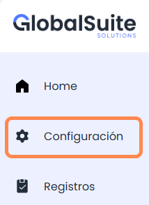

# Configuración

La opción de **Configuración** del menú sirve para gestionar aspectos generales de muestra información relativa al entorno de la empresa actual, incluyendo datos generales, licenciamiento, caducidad de licencia y gestión de usuarios.

Consta de dos pestañas o apartados:

* [Datos de empresa](datos-de-empresa.md): Apartado donde se puede ver información general de la empresa, caducidad de licencia y límite de conectores actual.
* [Usuarios](usuarios.md): Opción donde se pueden ver los usuarios de GlobalSuite con acceso al Marketplace y añadir o revocar accesos al mismo.
