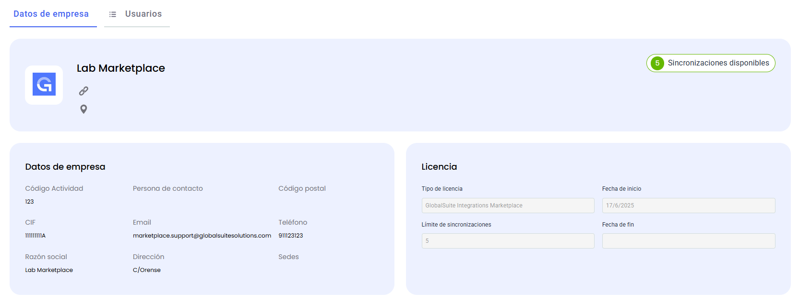
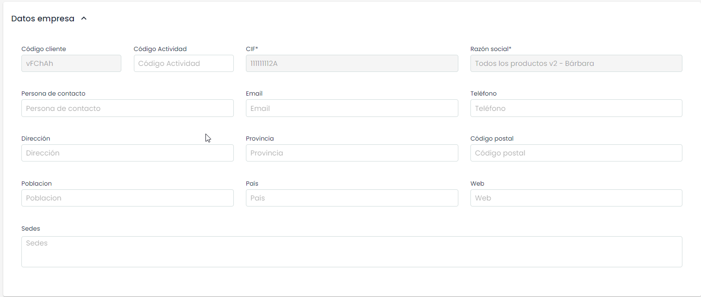
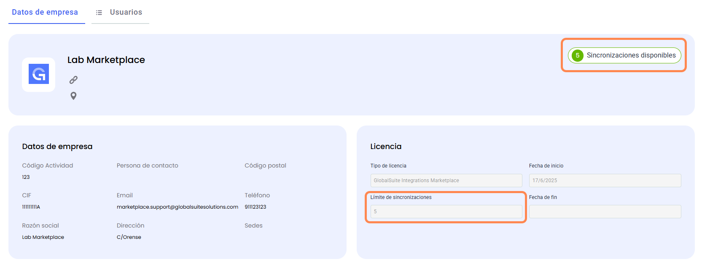

# Datos de Empresa

En este apartado se muestra información general de la empresa, caducidad de licencia y límite de conectores actual.

Estos datos de la compañía son los que están definidos en el apartado [Datos Empresa](https://globalsuitesolutions.atlassian.net/wiki/spaces/GlobalSUITEes/pages/266864171/Datos+Empresa) de GlobalSuite, y se modifican desde el mismo.

La caducidad de licencia será los que habilite el uso del Marketplace, y en el momento en que se desactive o caduque, dejará de estar operativo.

También se muestra el límite original de Sincronizaciones que hay habilitado en GlobalSuite, y cuántas sincronizaciones hay disponible en el momento (que será menor en caso de que se tengan sincronizaciones activadas).

