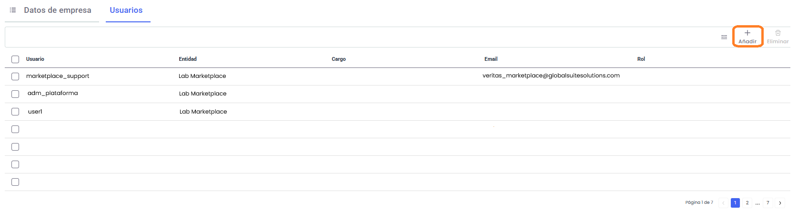

# Usuarios

En este apartado se pueden gestionar qué usuarios de GlobalSuite están autorizados para acceder al Marketplace de integraciones, pudiendo añadir o revocar el acceso a los usuarios en cualquier momento.

Para poder asociar nuevos usuarios se debe pulsar el botón **Añadir** de la barra superior, mientras que si se quiere quitar algún usuario, es necesario marcarlo en la tabla y se pulsará el botón **Eliminar** (el botón aparece desactivado mientras no se elimine ningún usuario.

*NOTA: En caso de que un usuario se elimine de GlobalSuite o se desactive, perderá también el acceso al Marketplace de Integraciones de manera inmediata.*
