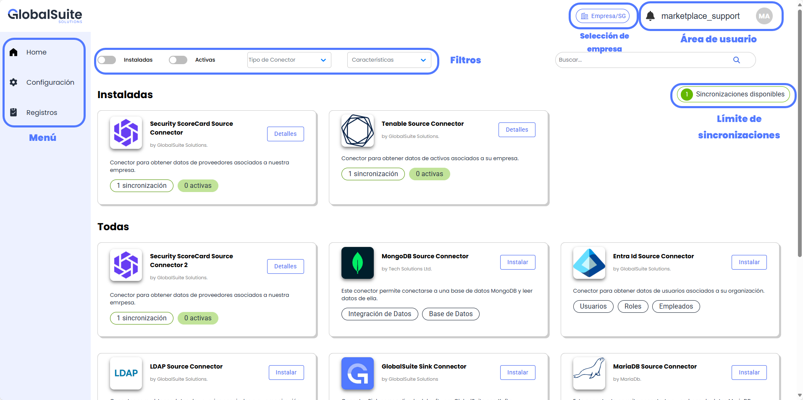
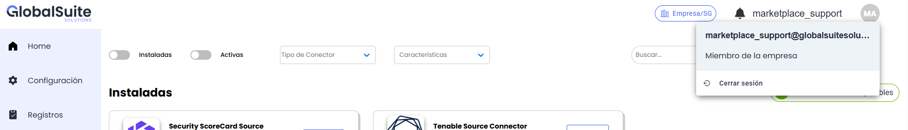
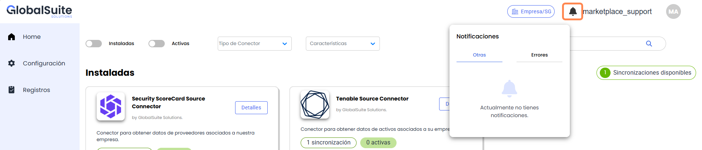
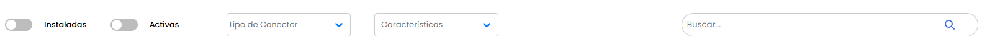
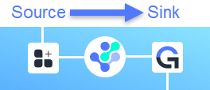
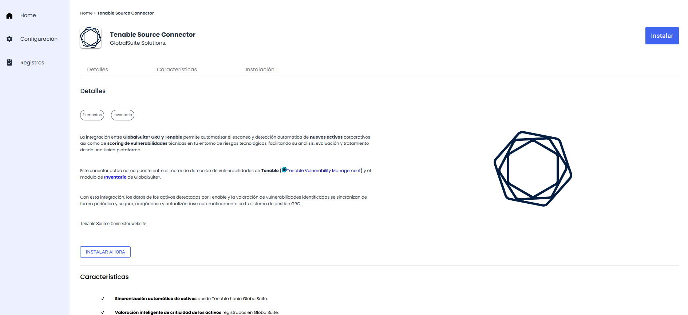
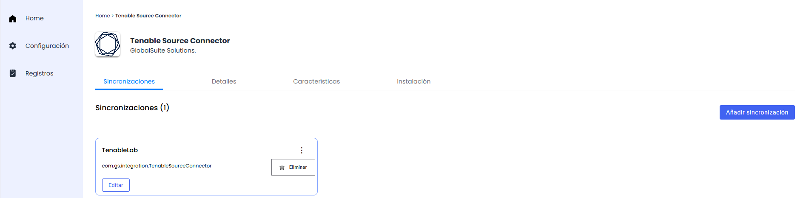
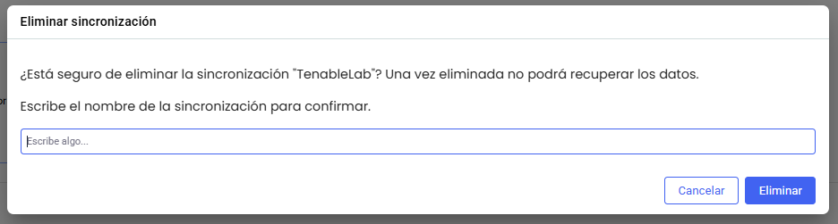
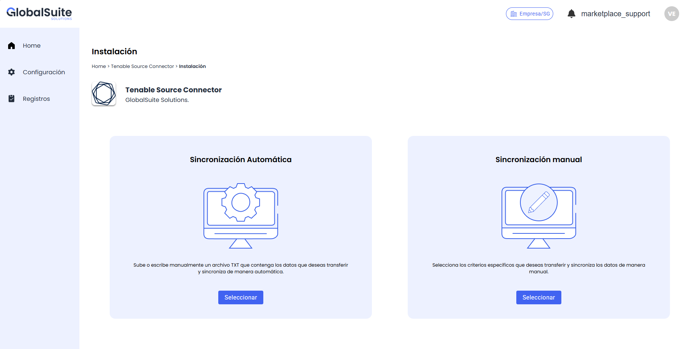

# Home

Una vez que se autentica en el Marketplace, se accede a la página inicial o **Home**, donde se dispone de distintos apartados de información estructurados de la siguiente manera:

## Área de usuario

En este apartado se puede visualizar el nombre y email del usuario que está logueado actualmente en el marketplace, y también posible cerrar sesión en la aplicación.

*NOTA: En caso de estar autenticado con un usuario de GlobalSuite autorizado en el marketplace, se cerrará sesión en ambas soluciones.*

En este área igualmente se tiene un apartado para consultar Notificaciones relevantes sobre el sistema:

El historial de estas notificaciones se pueden consultar en cualquier momento en el apartado de [Registros](../registros.md)

## Listado de Conectores

En esta vista de Home es posible visualizar los conectores que están disponibles en el Marketplace.

Existe la posibilidad de realizar varios filtros y búsquedas para localizar los que interesen

* **Instaladas**: En caso de marcarse, mostrará únicamente los conectores que tienen alguna configuración guardada en el Marketplace (estén activas o inactivas)
* **Activas**: Conectores en ejecución actualmente
* **Tipo de Conector**: Permite acotar el listado de conectores en función de si son de lectura (Source) o actualización (Sink).
* **Características**: Permite filtrar y buscar conectores por ámbito o palabras clave relacionadas.
* **Campo de Búsqueda**: Permite buscar por texto libre en cualquier apartado del conector para localizar los que interesen.

### Tipos de conectores

Dentro del Marketplace existen dos tipos principales de Conectores, relacionados entre sí:

* **Conectores Source** (lectura): Estos conectores lo que harán será obtener la información de la aplicación origen de forma periódica.  
  Estos conectores serán principalmente de aplicaciones o sistemas de terceros, para poder cargar esa información en GlobalSuite.
* **Conectores Sink** (sincronización / actualización): Estos conectores lo que permiten es leer la información de estas aplicaciones fuentes, para lo cual hay que elegir de qué conector leerá los datos, y permiten   
  Estos conectores tienen una potencia y capacidad de configuración mayor, ya que:

  * Permiten elegir la configuración o mapeo de campos donde se almacenará la información en GlobalSuite, debido a la gran capacidad de parametrización que tiene
  * Permiten decidir qué hacer con los registros que ya no estén en la aplicación origen (mantenerlos, eliminarlos)

### Conectores Instalados y Sincronizaciones disponibles

En caso de tener conectores instalados se mostrarán en primer lugar, además indicarán cuántas sincronizaciones de ese tipo hay creadas, y cuántas hay activas:

* **Sincronizaciones creadas**: Instancias del conector con una configuración existente (tanto activa como inactiva).
* **Sincronizaciones activas**: Instancias del conector que están activadas y en funcionamiento, ejecutándose con la frecuencia indicada. Estas **computan para el límite** de sincronizaciones disponibles en el licenciamiento.

### Información de un Conector

Cuando se accede a un conector del Marketplace, se muestra la información en distintos apartados:

* **Etiquetas**: Permite identificar el conector en función de su tipo o por palabras clave.
* **Detalles**: Explicación del caso de uso que se implementa en el conector.
* **Características**: Listado de los puntos más importantes que incluye el conector, incluyendo los beneficios que aporta.
* **Instalación**: Guía o resumen de los pasos a seguir y parámetros necesarios para activar la sincronización

#### Instancias de Conectores ya instaladas (Sincronizaciones en curso)

Cuando un conector tiene sincronizaciones creadas, dentro del formulario un primer apartado con las instancias que existan, pudiendo realizar acciones sobre las mismas:

Al pulsar el botón **Editar**, se accederá al formulario (de Sincronización manual) para modificar alguno de los parámetros de la configuración.

También será posible **Eliminar** esta instancia, en cuyo caso se mostrará un mensaje de confirmación para asegurar que no se produzcan borrados accidentales

### Activación de nuevo Conector

Si se quiere activar un conector, se puede realizar desde el detalle del mismo, en el botón **Instalar ahora**.

Esto sólo será posible si no se ha alcanzado el Límite de Sincronizaciones definido en el licenciamiento.

Existen dos formas de configurar y activar un nuevo Conector. Puedes ver la explicación de cada uno de ellos en el apartado correspondiente:

* [Sincronización automática](sincronizacion-automatica.md): Sirve para cargar directamente una configuración ya definida en formato JSON
* [Sincronización manual](sincronizacion-manual.md): Permite configurar mediante un formulario guiado, los campos necesarios para la sincronización, incluyendo mecanismos de autenticación, mapeos, frecuencia de actualización, etc.

