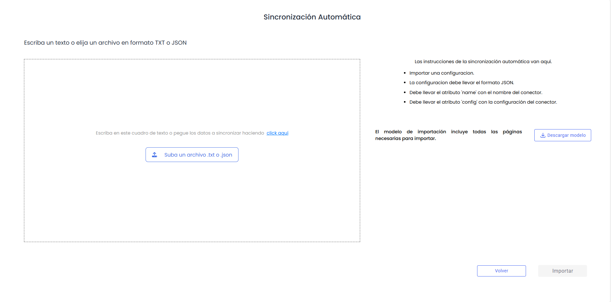
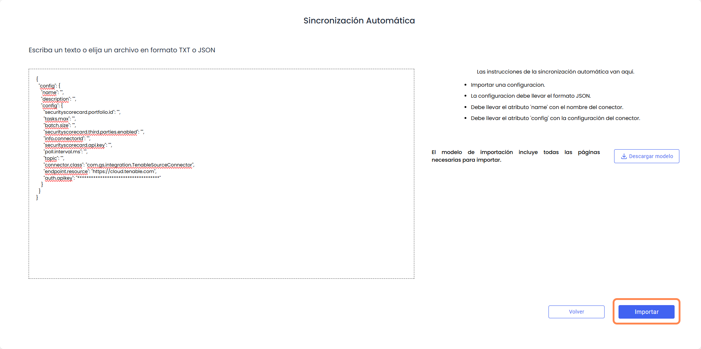
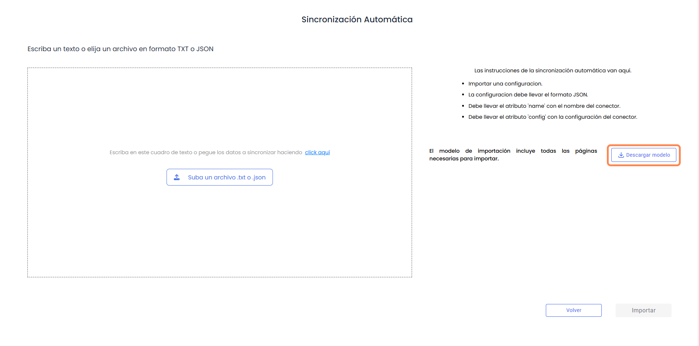

# Sincronización automática

Este mecanismo de sincronización permite cargar la ínformación y parámetros necesarios para activar el conector de forma directa, en un formato estructurado JSON.

De manera habitual, esta forma de sincronización sirve para restaurar sincronizaciones ya creadas, o para cargar sincronizaciones probadas en un entorno de laboratorio o pre-producción y vayan a cargarse de manera definitiva.

Si no se tiene conocimiento de cómo configurar un conector, se recomienda utilizar la [Sincronización manual](sincronizacion-manual.md).

En este apartado, el formulario de sincronización se compone de un único campo donde copiar la configuración del conector:

En este campo es posible arrastrar archivos con formato txt (texto plano) o json con los parámetros del conector

También es posible pegar desde otra fuente mediante Ctrl+V o pulsando en el link de click aquí, lo cual lee y pega el portapapeles del equipo.

En cualquier momento será posible cancelar la activación del conector pulsando el botón **Volver.**

Una vez se tenga el JSON del conector, se activará el botón **Importar** para poder crear el conector

De manera auxiliar, se dispone del botón Descargar modelo que descarga en el equipo del usuario un archivo .txt con el ejemplo de estructura y parámetros que necesita el conector y que hay que completar.

Ejemplo conector Tenable:

`{`  
 `"config": {`  
 `"name": "",`  
 `"description": "",`  
 `"config": {`  
 `"securityscorecard.portfolio.id": "",`  
 `"tasks.max": "",`  
 `"batch.size": "",`  
 `"securityscorecard.third.parties.enabled": "",`  
 `"info.connectorId": "",`  
 `"securityscorecard.api.key": "",`  
 `"poll.interval.ms": "",`  
 `"topic": "",`  
 `"connector.class": "com.gs.integration.TenableSourceConnector",`  
 `"endpoint.resource": "https://cloud.tenable.com",`  
 `"auth.apikey": "************************************"`  
 `}`  
 `}`  
`}`
