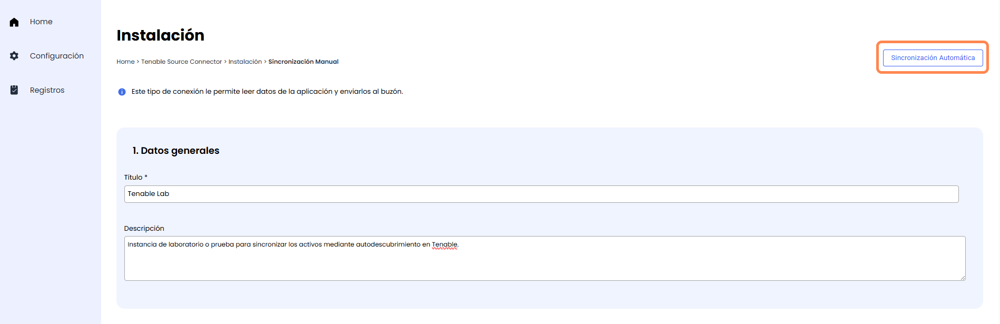
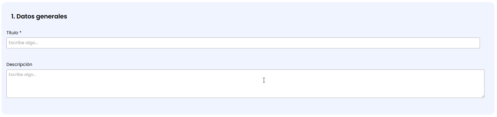
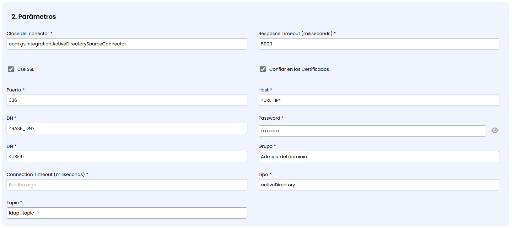
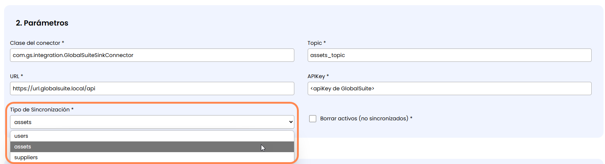
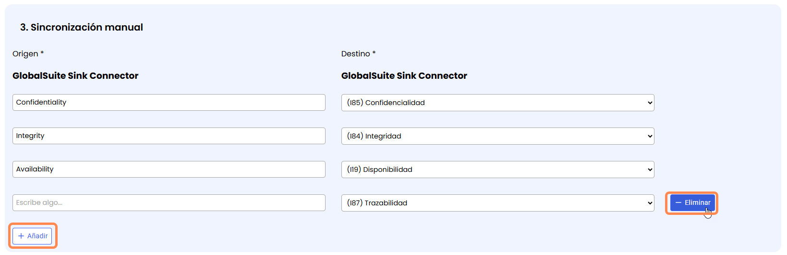
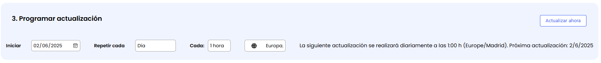
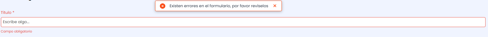

# Sincronización manual

Este mecanismo de sincronización permite configurar o modelar un conector con los distintos parámetros o campos que son necesarios en cada uno paso a paso y de forma guiada.

En cualquier momento se puede alternar con el otro mecanismo de sincronización, que es la [Sincronización automática](sincronizacion-automatica.md).

## Apartados del formulario de Sincronización manual

### Datos Generales

Este primer apartado permite completar dos campos textuales:

* **Título**: Es un campo obligatorio y sirve para identificar con un texto corto la instancia o sincronización concreta. Con este nombre se identificará la configuración en las distintas partes del Marketplace, incluyendo en el apartado de [Registros](../registros.md)  
  NOTA: Es importante poner un nombre descriptivo ya que pueden existir varias instancias o sincronizaciones de un mismo tipo de conector
* **Descripción**: Permite añadir información adicional o explicar el objetivo o alcance de la sincronización de manera extendida.

### Parámetros

En este apartado se tienen que completar los campos generales de configuración del conector. Entre otros se deberán configurar los siguientes:

* **Topic**: Identificador de la fuente de la cual tiene que obtener los datos para sincronizar en GlobalSuite.

  * Para los conectores Source, será el espacio donde se volcará la información periódica que se lea
  * Para los conectores tipo Sink, será el origen desde el que se tomarán los datos a cargar  
    NOTA: Este topic tiene que coincidir con el de uno de los conectores Source que leen información de herramientas externos para que funcione correctamente
* **URL**: La URL o IP de la aplicación o sistema con el que se conectará el Marketplace
* **APIKey**: Clave de uso del API. En otros casos se utilizarán otros mecanismos de credenciales como Usuario y Contraseña
* **Parámetros adicionales**: En función del tipo de conector se necesitarán unos parámetros específicos.

* **Tipo de Sincronización**: Campo que estará únicamente disponible para los conectores Sink, e indica qué información va a escribir. Actualmente se cuenta con la posibilidad de cargar Activos (assets), Usuarios (users) ó Proveedores (suppliers).

### Sincronización manual

Este apartado está disponible únicamente para los conectores de tipo **Sink**, y permite modelar la relación o **mapeo** de qué parámetros del origen se cargarán en qué campo de GlobalSuite.

*NOTA: Para los conectores de tipo Source (lectura), no existe un mapeo o selección de campos ya que se obtienen todos los campos disponibles, descritos en la documentación de cada conector.*

Se pueden añadir nuevos parámetros a mapear pulsando en el botón **Añadir** de la parte inferior del apartado.

En caso de querer eliminar alguna de estas relaciones, se podrá borrar pulsando en el botón **Eliminar** que aparece al pasar el cursor por cada fila.

Los campos a mapear dependerán del tipo de conector, pudiendo ser campos generales o dimensiones configuradas en la metodología.

### Programar actualización

En este último apartado del formulario se puede definir la frecuencia de sincronización, con los siguientes parámetros.

* **Inicio**: Indica la fecha a partir de la cual se ejecutará periódicamente
* **Repetir cada**: Se indica la frecuencia que podrá ser de distintos tipos

  * Día: La sincronización de lanzará ininterrumpidamente todos los días, pudiendo elegir cada cuántas horas se lanza
  * Semana: Se podrán marcar qué días de la semana se lanza la sincronización del conector
  * Mes: Se lanzará mensualmente el mismo día de meses sucesivos a partir de la fecha de Iniciar la sincronización.

En todos los casos se podrá definir el huso horario en el que se ejecutará el conector.

Además de una programación, se dispone del botón **Actualizar Ahora** para forzar la ejecución de la sincronización en ese momento (a efectos de realizar pruebas o validaciones).

## Acciones generales

Con el formulario de Sincronización manual de un Conector, se pueden realizar las siguientes acciones:

* **Cancelar**: Al pulsarlo, no se realizará ningún cambio sobre la sincronización, lo cual puede ser la modificación sobre una sincronización ya existente, o la creación de una nueva instancia.
* **Guardar**: Cuando se pulse, se almacenarán todos los datos introducidos en la sincronización. En caso de que exista alguna incoherencia o campo obligatorio no completado, se mostrará un mensaje de error

**Activar**: Sólo es posible para sincronizaciones ya creadas y con todos los campos obligatorios completados y guardados.

En el momento de Activar una sincronización se ejecuta de manera forzada, para continuar ejecutándose con la frecuencia definida.
