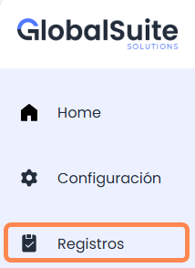
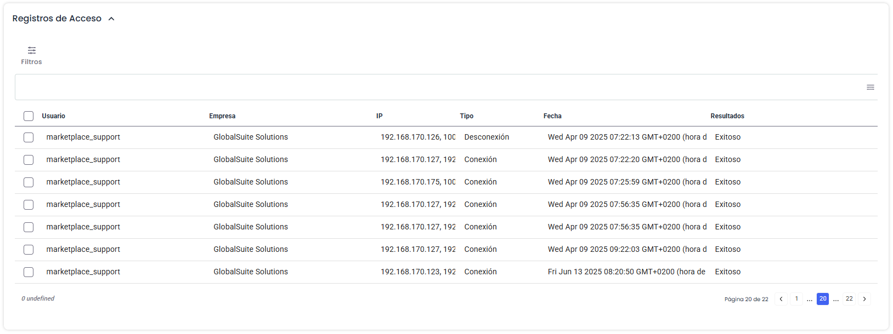
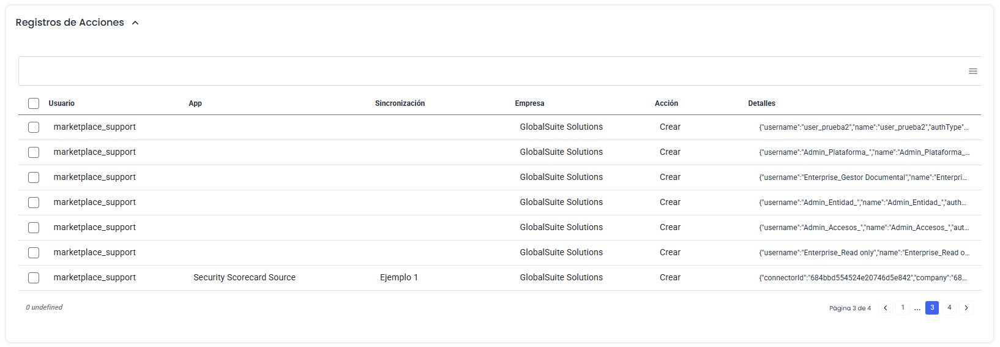
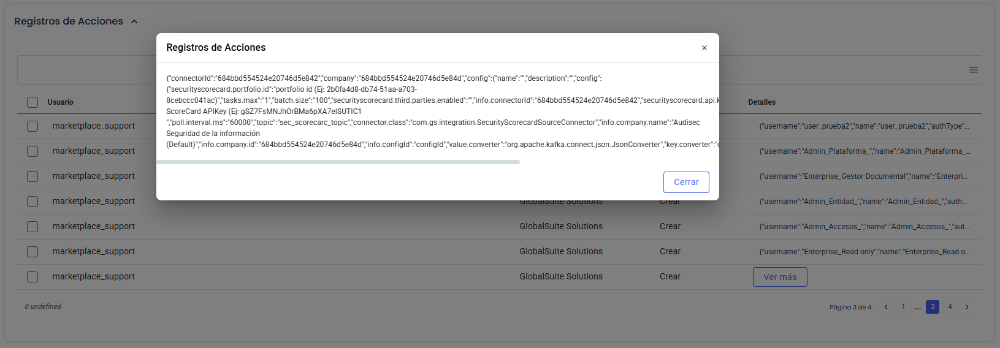
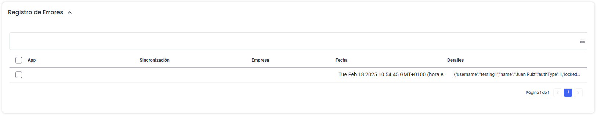
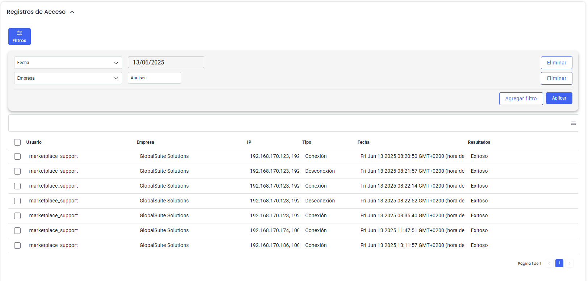

# Registros

En este apartado se pueden consultar los logs que sustentan la trazabilidad de la información y que se recopilan en la solución.

En el Marketplace de GlobalSuite, todas las acciones quedan registradas para dejar evidencia y poder consultarse en cualquier momento.

Existen tres tipos de registros que se especifican a continuación.

## Registros de Acceso

En este apartado se muestran todos los intentos de **autenticación**, tanto exitosos como fallidos de los usuarios autorizados en el Marketplace, así como cierres de sesión (desconexión) dejando información centralizada en la plataforma.

La información registrada incluye estos campos:

* **Usuario**: Nombre del usuario que realiza la conexión al Marketplace
* **Empresa**: Nombre de la empresa a la que pertenece ese usuario
* **IP**: Dirección IP desde la que se realiza el proceso  
  *Nota: en caso de disponer de proxy o VPN, puede que no sea la dirección origen desde la que se hace el acceso*
* **Tipo**: Indica si el registro es de Conexión o Desconexión (cierre de sesión) del usuario
* **Fecha**: Fecha y hora a la que se hace la conexión
* **Resultados**: Si el intento de conexión ha sido Exitoso o ha sido Fallido

## Registros de Acciones

En esta tabla se muestran todas las acciones realizadas sobre el Marketplace, indicando qué usuario fue el que realizó la acción.

Dentro del alcance de esta información, se incluye cambios sobre la empresa, sobre los usuarios (activaciones / eliminaciones), sobre los conectores y las instancias de los mismos.

La información que incluyen estos logs es:

* **Usuario**: Nombre del usuario que realiza la acción
* **App**: Nombre o tipo del Conector sobre el que se están realizando cambios (en caso de que no sea una acción sobre un conector, estará vacío)
* **Sincronización**: Nombre específico de una instancia del conector (en caso de que no sea una acción sobre un conector, estará vacío)
* **Empresa**: Nombre de la empresa sobre la que se realiza la acción
* **Acción**: Indica si el registro refleja la Creación, Modificación o Eliminación de un registro
* **Fecha**: Fecha y hora a la que se hace la conexión
* **Detalles**: Muestra un detalle de la información que incluye el registro. Si se quiere mostrar de forma completa, se puede pulsar en el botón Ver más, que aparece al pasar el cursor por esa fila.

## Registros de Errores

En caso de que se produzca un problema en la ejecución de sincronización de información en una instancia del conector, se podrá consultar el detalle del error en esta tabla, para poder ajustar la configuración en caso de que sea necesario.

* **App**: Nombre o tipo del Conector sobre el que se ha producido el error
* **Sincronización**: Nombre específico de una instancia del conector que ha fallado
* **Empresa**: Nombre de la empresa a la que pertenece el conector
* **Fecha**: Fecha y hora a la que se produce el error
* **Detalles**: Muestra un detalle del error que se ha producido para analizar la causa. Si se quiere mostrar de forma completa, se puede pulsar en el botón Ver más, que aparece al pasar el cursor por esa fila.

### Filtros

Es posible aplicar filtros sobre uno o varios de los campos incluidos en los registros para poder localizar o acotar la información que se muestra.

Para ello, se deberá pulsar en el botón de Filtros que aparece en la parte superior, y seleccionar un campo para filtrar.

En función del tipo de campo, el filtro será un seleccionable de un conjunto de valores, o un campo de texto para filtrar por el contenido que se introduzca ahí.

Si se quieren añadir filtros adicionales, se pulsará el botón “Agregar filtro”, y si se quiere eliminar alguno, se deberá pulsar en “Eliminar”. Si se aplica más de un filtro, solamente se mostrarán los resultados que coincidan con todos ellos.

Al pulsar Aplicar, se aplicarán los filtros creados y se mostrarán en la tabla los resultados que coincidan con la búsqueda

