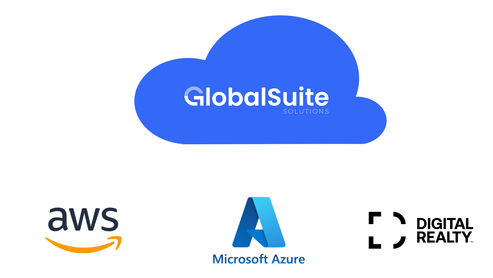

# Descripción general de la infraestructura

Los productos de GlobalSuite Solutions, en su modalidad SaaS, se encuentran desplegados en una infraestructura cloud administrada y gestionada por personal de GlobalSuite Solutions. Esta arquitectura, físicamente, se encuentra separadas en distintas regiones localizadas dentro del ámbito europeo.

De manera general, nuestras soluciones utilizan una arquitectura basada en microservicios para asegurar su escalabilidad. Cada una de las instancias de nuestros clientes conviven en un entorno multi-tenant con una segregación lógica de los datos y de los procesos que los tratan.

Principalmente disponemos de tres centros de datos productivos: Digital Reality (Interxion), AWS y Azure. Además, para dar producción, utilizamos también una serie de proveedores que proporcionan una servicios transversales; gestión de la identidad de usuarios, herramientas de gestión de vulnerabilidades, analítica de datos, etc.

Esta redundancia de centros de datos y servicios basada en diferentes proveedores nos permite disponer de estrategias de continuidad basadas en la redundancia y la recuperación de nuestros servicios ante la ocurrencia de un evento disruptivo.

## [Digital Reality](https://www.digitalrealty.es/)

En este centro de datos se encuentran recursos de cómputo, conectividad e información, se trata de un punto de acceso a nuestra infraestructura y al consumo de nuestros productos.

Además de los recursos mencionados, disponemos de sistemas de protección perimetral que permiten prestar nuestros servicios de una manera segura y confiable.

## [AWS](https://aws.amazon.com/)

En este centro de datos se encuentran recursos de cómputo, conectividad e información, se trata de un punto de acceso a nuestra infraestructura y al consumo de nuestros productos.

Utilizamos esta infraestructura de nube pública para disponer de un entorno de contingencia ante una situación de continuidad de negocio.

## [Azure](https://azure.microsoft.com/)

Este centro de datos nos permite disponer de recursos de cómputo, conectividad y almacenamiento en la nube.

La infraestructura de Azure nos ofrece la capacidad de escalar nuestras operaciones de manera ágil y eficiente, asegurando la continuidad del negocio y proporcionando un entorno robusto y seguro para nuestras aplicaciones críticas. Además, sus herramientas avanzadas de seguridad y análisis nos permiten mantener altos estándares de protección y optimización en nuestras soluciones.

---
